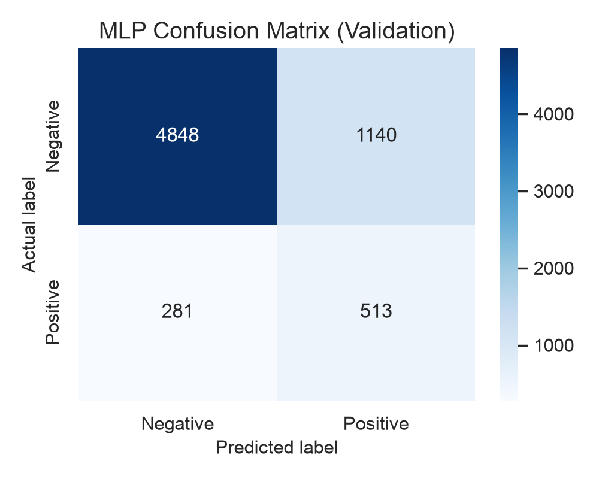
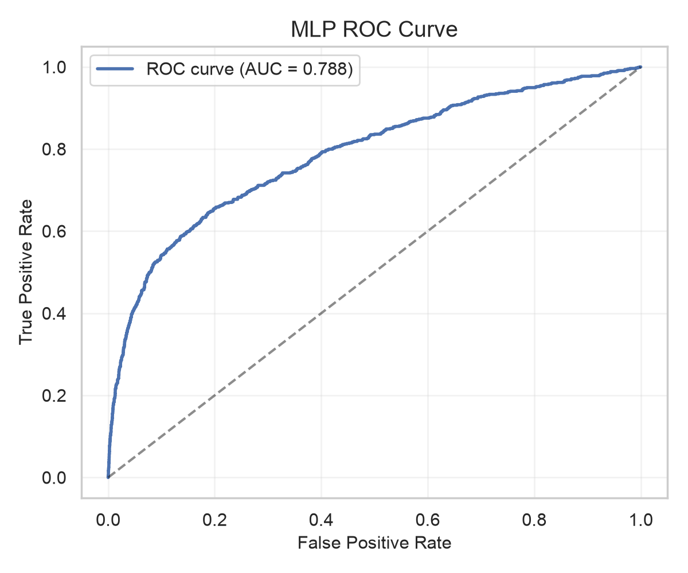
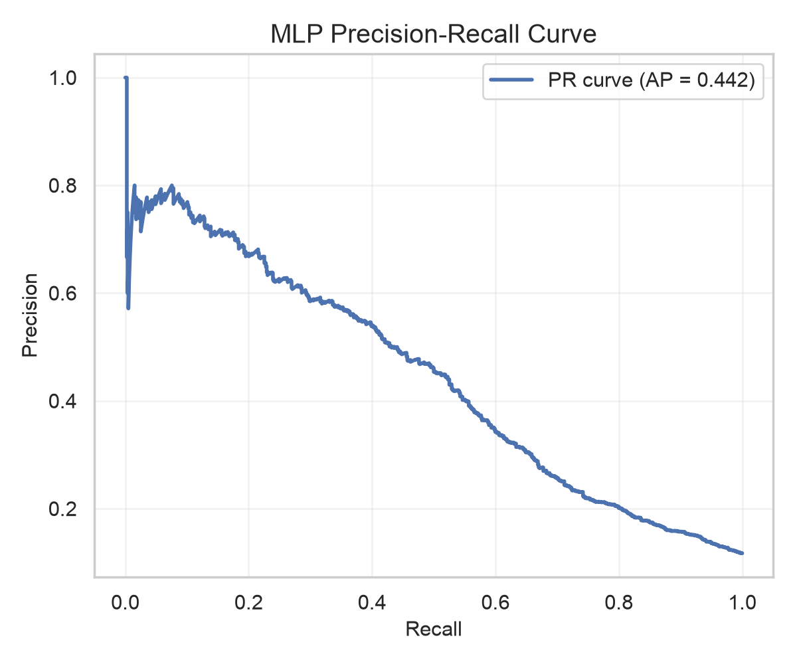
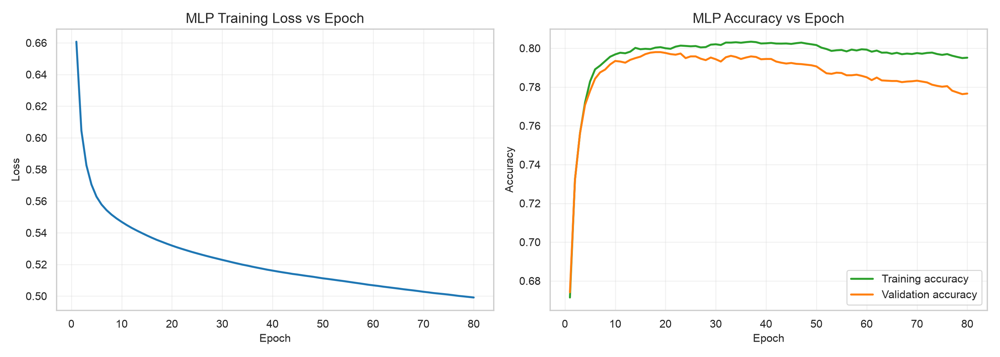

# Bank Marketing EDA & Deep Learning

## 1. Project Overview

This project analyzes a real-world bank marketing dataset to understand customer and campaign characteristics associated with term-deposit subscription. The work combines exploratory data analysis, data cleaning, preprocessing, traditional machine learning, and a Multilayer Perceptron (MLP) deep-learning baseline.

The project is designed for academic exploration and portfolio presentation. It uses historical campaign data to investigate predictive patterns, but it does not claim to establish causality or deployment-readiness.

## 2. Project Objectives

The main objectives of this project are to:

- Explore the real bank marketing dataset.
- Inspect data quality, missing values, duplicates, and class imbalance.
- Prepare and transform features for modeling.
- Compare multiple traditional machine-learning classifiers.
- Train and evaluate an MLP neural network.
- Use validation data for model selection and keep the test set for the final descriptive evaluation.
- Interpret model behavior using evaluation metrics and feature-importance analysis.
- Document the workflow and findings clearly for academic review.

## 3. Dataset Description

The project uses the UCI Bank Marketing dataset, also known as the Portuguese bank marketing dataset for direct marketing.

- Official source: https://archive.ics.uci.edu/dataset/222/bank+marketing
- Dataset file: `data/bank/bank-full.csv`
- Reference citation: Moro, S., Laureano, R., & Cortez, P. (2011). Using Data Mining for Bank Direct Marketing: An Application of the CRISP-DM Methodology.
- Rows: 45,211
- Columns: 17 total
- Target variable: `y`
- Prediction task: Determine whether a client subscribed to a term deposit (`yes` or `no`)

The dataset contains customer demographics, campaign information, and prior campaign outcomes. The target is binary and imbalanced. In the verified project data, the target distribution is approximately:

- `no`: 39,922
- `yes`: 5,289

This corresponds to about 11.7% positive cases, which is why average precision and recall are emphasized alongside accuracy.

## 4. Project Workflow

The project follows this workflow:

1. Load the raw dataset and inspect the data dictionary.
2. Perform exploratory data analysis (EDA).
3. Check missing values, duplicate rows, invalid categories, and basic numeric constraints.
4. Clean and prepare the data for modeling.
5. Apply the preprocessing pipeline to the training set only.
6. Create a stratified train/validation/test split.
7. Train and compare traditional machine-learning classifiers.
8. Train the MLP classifier using the same preprocessing pipeline.
9. Evaluate models on validation and test data using appropriate metrics.
10. Create feature-importance and evaluation visualizations.
11. Summarize results, limitations, and future improvements.

## 5. Exploratory Data Analysis

The project includes several EDA steps that inspect the dataset before modeling:

- Descriptive statistics and target distribution.
- Numeric feature distributions.
- Categorical feature analysis and subscription patterns.
- Missing-value and duplicate checks.
- Outlier and domain-validity checks.
- Correlation and relationship exploration for relevant variables.
- Review of campaign and prior-contact variables such as `pdays`, `poutcome`, and `month`.

These checks help explain the business and technical structure of the data. They also support the decision to treat class imbalance and leakage risk seriously.

## 6. Data Preprocessing

The actual project preprocessing workflow is based on the notebook implementation and saved preprocessing artifact. It includes:

- Numeric feature imputation using the median.
- Standard scaling for numerical features.
- Categorical feature imputation using the most frequent category.
- One-hot encoding for categorical features.
- Fitting preprocessing only on the training set.
- Use of a stratified split to preserve label proportions.

The notebook also explicitly keeps `duration` out of the predictive feature set because it is only known after the marketing call and would create leakage if used for pre-call prediction. This is a key requirement for a realistic bank-marketing model.

## 7. Machine Learning Models

The project compares several supervised models that were actually implemented and evaluated in the notebook:

- Dummy classifier baseline
- Logistic Regression
- Decision Tree
- Random Forest

These model comparisons help establish a realistic benchmark before deep-learning testing. The notebook uses validation-based selection and does not tune on the final test set.

## 8. Deep Learning Model

The project includes a deep-learning requirement using scikit-learn's `MLPClassifier`.

Verified MLP configuration from the project notebook:

- Model: `sklearn.neural_network.MLPClassifier`
- Hidden layers: `(32, 16)`
- Activation: ReLU
- Solver: Adam
- Learning rate initialization: `0.0005`
- Regularization (`alpha`): `0.0001`
- Maximum iterations: `400`

The model uses the same fitted preprocessing pipeline as the traditional models and is trained on the training partition only. Validation data is used for model selection and comparison, while the test set remains reserved for the final descriptive evaluation.

## 9. Model Evaluation

The project reports several genuine performance metrics:

- Accuracy
- Precision
- Recall
- F1-score
- ROC-AUC
- Average Precision (primary validation metric for class imbalance)

Important note: the target class is imbalanced, so accuracy alone is not a sufficient measure of success. Average precision and recall are more informative in this setting.

The project also saves and generates evaluation visualizations, including:

- Confusion matrix
- ROC curve
- Precision-recall curve
- Training loss curve
- Training/validation accuracy curve
- Predicted probability distribution

### Verified validation metric summary

| Model | Accuracy | Precision | Recall | F1-score | ROC-AUC | Average Precision |
|---|---:|---:|---:|---:|---:|---:|
| Random Forest (Validation) | 0.830286 | 0.367089 | 0.620907 | 0.461394 | 0.801578 | 0.466663 |
| MLP (Validation) | 0.790475 | 0.310345 | 0.646096 | 0.419289 | 0.787711 | 0.442488 |

### Verified test metric summary

| Model | Accuracy | Precision | Recall | F1-score | ROC-AUC | Average Precision |
|---|---:|---:|---:|---:|---:|---:|
| Random Forest (Test) | 0.829696 | 0.362462 | 0.601513 | 0.452347 | 0.791923 | 0.454367 |
| MLP (Test) | 0.792981 | 0.307982 | 0.617907 | 0.411074 | 0.776805 | 0.425166 |

These values are taken from the saved project results and should be interpreted as dataset-specific model performance estimates, not causal claims.

## 10. Key Findings

The project highlights several meaningful patterns:

- The target variable is imbalanced, with far fewer positive subscription outcomes than negative outcomes.
- Prior campaign outcomes and contact-related variables are important for predictive ranking.
- The `duration` feature is excluded from model inputs to prevent target leakage.
- The Random Forest benchmark remains slightly stronger than the MLP on validation average precision for this dataset.
- Model performance is informative for historical pattern detection, but not proof of causal effect or deployment readiness.

## 11. Repository Structure

```text
bank-marketing-eda-deep-learning/
├── notebooks/
│   └── bank_marketing_eda.ipynb
├── data/
│   └── bank/
│       ├── bank-full.csv
│       ├── bank-names.txt
│       └── bank.csv
├── models/
│   ├── bank_marketing_preprocessor.joblib
│   ├── bank_marketing_best_model.joblib
│   ├── bank_marketing_best_model_phase6.joblib
│   ├── bank_marketing_phase6_tuned_model.joblib
│   └── bank_marketing_mlp_phase8.joblib
├── outputs/
│   └── plots/
├── results/
│   ├── phase5_classification_report.csv
│   ├── phase5_test_metrics.csv
│   ├── phase5_validation_metrics.csv
│   ├── phase6_*.csv
│   ├── phase7/
│   └── phase8/
├── FINAL_SUBMISSION_AUDIT.md
├── PHASE7_PROJECT_SUMMARY.md
├── README.md
├── requirements.txt
├── .gitignore
└── .venv/  (local environment, not committed)
```

## 12. Technologies Used

- Python
- Jupyter Notebook
- Pandas
- NumPy
- Matplotlib
- Seaborn
- Scikit-learn
- Joblib
- Machine learning model comparison and evaluation
- Multilayer Perceptron (MLP)

## 13. Installation and Setup

Clone the repository:

```bash
git clone https://github.com/mandaldhananjay248-beep/bank-marketing-eda-deep-learning.git
cd bank-marketing-eda-deep-learning
```

Create and activate a virtual environment:

```bash
python3 -m venv .venv
source .venv/bin/activate
```

Install dependencies:

```bash
pip install -r requirements.txt
```

The project uses the dataset in `data/bank/bank-full.csv`. If you are working from a fresh environment without the repository copy, download the official dataset from the UCI source and place it in the same directory structure before running the notebook.

## 14. How to Run the Project

1. Activate the environment.
2. Open Jupyter Notebook or Jupyter Lab.
3. Run the notebook at `notebooks/bank_marketing_eda.ipynb`.
4. Ensure the project root is identified correctly by the notebook helper logic.
5. Reuse the saved model files if needed for inference or evaluation.

```bash
source .venv/bin/activate
jupyter notebook notebooks/bank_marketing_eda.ipynb
```

## 15. Results and Visualizations

The repository includes saved figures and evaluation outputs. A few representative figures are shown below.









## 16. Project Documentation

The project contains useful follow-up documentation:

- [notebooks/bank_marketing_eda.ipynb](notebooks/bank_marketing_eda.ipynb)
- [PHASE7_PROJECT_SUMMARY.md](PHASE7_PROJECT_SUMMARY.md)
- [FINAL_SUBMISSION_AUDIT.md](FINAL_SUBMISSION_AUDIT.md)
- [results/phase8](results/phase8)
- [results/figures/phase8](results/figures/phase8)

## 17. Limitations

This project is a historical academic analysis and has several important limitations:

- Results are observational and not causal.
- The dataset reflects historical campaign behavior, not necessarily future response patterns.
- Class imbalance affects metric interpretation.
- Threshold settings are case-specific and do not encode real business costs.
- The project is not a production decision system and should not be used as a direct campaign policy tool without additional validation and fairness review.

## 18. Future Improvements

Reasonable next steps include:

- More systematic hyperparameter tuning.
- Calibration and threshold analysis under realistic business costs.
- Additional model comparison with XGBoost or other gradient-boosted methods.
- External validation on a newer or separate dataset.
- More formal fairness and privacy review before any operational deployment.

## 19. Author

Dhananjay Prasad Mandal

GitHub: https://github.com/mandaldhananjay248-beep

## 20. License and Academic Use

No explicit open-source license file is included in this repository at the moment. The dataset itself is a public UCI dataset and should be used in accordance with the official source and any relevant redistribution terms. This project is intended for academic and portfolio use, and reuse should be consistent with the dataset source and the repository's current documentation.

This project is presented as a transparent educational analysis rather than a production-ready system.
